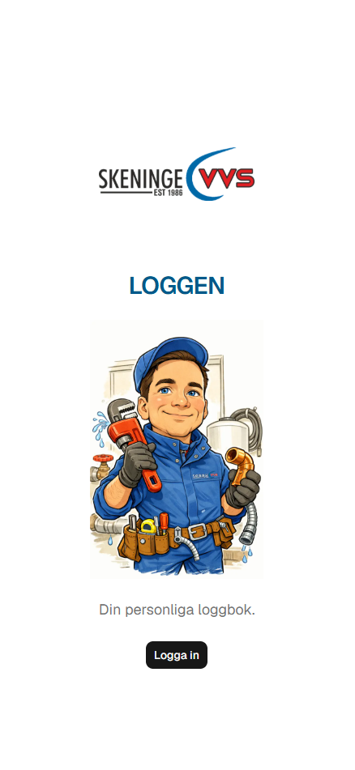
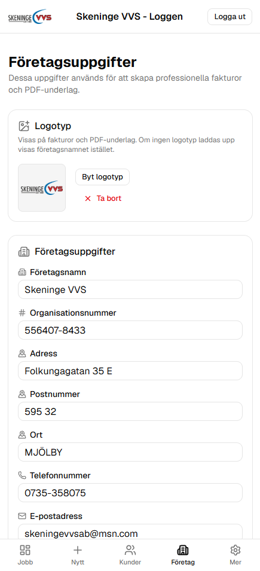

# Skeningevvs-loggen

Personal job, customer, and invoice log for a one-person plumbing/HVAC (VVS) business. Built for a single user — no multi-tenancy, no team, no subscription.

## Screenshots

<table>
  <tr>
    <td align="center" width="33%">
      <br />
      <sub>Home page</sub>
    </td>
    <td align="center" width="33%">
      <br />
      <sub>My jobs</sub>
    </td>
    <td align="center" width="33%">
      <br />
      <sub>Job overview</sub>
    </td>
  </tr>
  <tr>
    <td align="center" width="33%">
      <br />
      <sub>Customer register</sub>
    </td>
    <td align="center" width="33%">
      <br />
      <sub>Company details</sub>
    </td>
    <td align="center" width="33%">
      <br />
      <sub>Invoice</sub>
    </td>
  </tr>
</table>

## Features

- **Jobs**: log articles, miscellaneous costs, trips, work hours, photos, fixed or itemized pricing, status (not started / in progress / done), invoicing and payment status
- **Customers**: private individuals and companies, with ROT deduction details (property designation, apartment number, housing association)
- **Invoices**: print or download as PDF, with a running invoice number, ROT tax deduction, F-tax status, and payment details (bankgiro/plusgiro/swish) — no email sending
- **Quotes**: price a job before it is ordered (materials, estimated hours and mileage, or a fixed price, with preliminary ROT deduction), print or download as PDF with its own quote number and validity date, and turn an accepted quote into a job
- **Company details**: logo, contact info, invoice settings
- **Image uploads** for job photos and company logo via UploadThing
- **Login**: email + password, no email verification. Only one account can ever be registered.

## Tech stack

- [Next.js 16](https://nextjs.org/docs) (App Router, Turbopack) + React 19
- [Tailwind CSS 4](https://tailwindcss.com/) + [shadcn/ui](https://ui.shadcn.com/)
- [Prisma](https://www.prisma.io/) + PostgreSQL (e.g. [Neon](https://neon.tech/))
- [better-auth](https://www.better-auth.com/) for authentication
- [react-hook-form](https://react-hook-form.com/) + [zod](https://zod.dev/) for forms and validation
- [@react-pdf/renderer](https://react-pdf.org/) for invoice generation
- [UploadThing](https://uploadthing.com/) for file uploads

## Getting started

### 1. Environment variables

Copy `.env.example` to `.env` and fill in:

```bash
DATABASE_URL=        # Postgres connection string (e.g. Neon)
BETTER_AUTH_SECRET=  # random secret key, at least 32 characters (openssl rand -base64 32)
BETTER_AUTH_URL=     # https://your-domain, or http://localhost:3000 locally
UPLOADTHING_TOKEN=   # from https://uploadthing.com/dashboard
```

### 2. Install dependencies and migrate the database

```bash
npm install
npm run db:migrate
```

### 3. Start the dev server

```bash
npm run dev
```

Open [http://localhost:3000](http://localhost:3000), go to `/registrera` and create your (only) account.

## Scripts

| Command               | Description                              |
| --------------------- | ----------------------------------------- |
| `npm run dev`          | Starts the dev server (Turbopack)         |
| `npm run build`        | Generates the Prisma client and builds the app |
| `npm run start`        | Starts the built app                      |
| `npm run lint`         | Runs ESLint                               |
| `npm run db:migrate`   | Runs Prisma migrations against the database |

## Structure

```
src/
├── app/
│   ├── logga-in/, registrera/     # Login and registration
│   ├── api/auth/, api/uploadthing/ # better-auth and UploadThing handlers
│   └── mina-sidor/                 # Protected area: jobs, quotes, customers, company, settings
├── components/
│   ├── ui/                         # shadcn/ui components
│   └── minasidor/                  # Business-logic UI (jobs, quotes, customers, invoices, company, overview)
├── lib/                            # auth, prisma, job-actions, job-schema, uploadthing, env
└── proxy.ts                        # Route protection (must live in src/, not the project root)
prisma/
└── schema.prisma                   # User/Session/Account (auth) + Company/Customer/Job/Offert (business data)
```

## Deployment

The app is built to run on Vercel with an external Postgres database (e.g. Neon). Set the same environment variables as above in the project settings, with `BETTER_AUTH_URL` set to the production `https://` domain.
