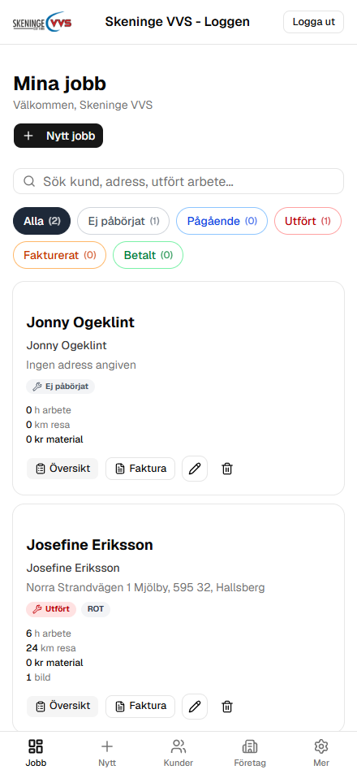
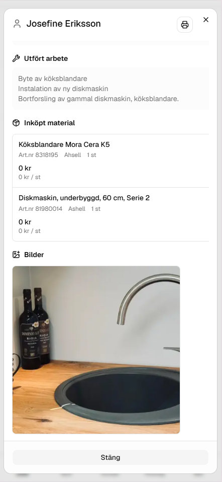
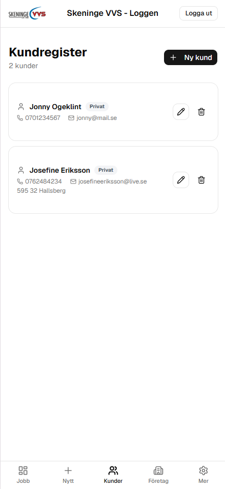
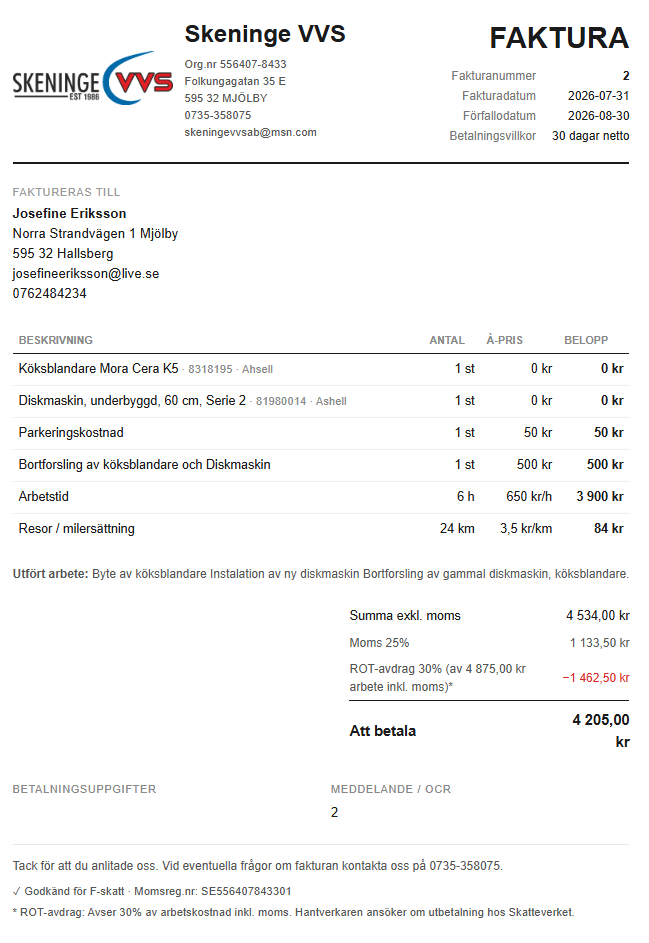

# Skeningevvs-loggen

Personal job, customer, and invoice log for a one-person plumbing/HVAC (VVS) business. Built for a single user — no multi-tenancy, no team, no subscription.

## Screenshots

<table>
  <tr>
    <td align="center" width="33%">
      <br />
      <sub>Home page</sub>
    </td>
    <td align="center" width="33%">
      <br />
      <sub>My jobs</sub>
    </td>
    <td align="center" width="33%">
      <br />
      <sub>Job overview</sub>
    </td>
  </tr>
  <tr>
    <td align="center" width="33%">
      <br />
      <sub>Customer register</sub>
    </td>
    <td align="center" width="33%">
      <br />
      <sub>Company details</sub>
    </td>
    <td align="center" width="33%">
      <br />
      <sub>Invoice</sub>
    </td>
  </tr>
</table>

## Features

- **Jobs**: log articles, miscellaneous costs, trips, work hours, photos, fixed or itemized pricing, status (not started / in progress / done), invoicing and payment status, follow-up flag with date, and internal notes that never appear on the invoice
- **Customers**: private individuals and companies, with ROT deduction details (property designation, apartment number, housing association)
- **Invoices**: print or download as PDF, with a running invoice number, ROT tax deduction, reverse-charge VAT for construction companies, F-tax status, VAT number, date of service and payment details (bankgiro/plusgiro/swish) — no email sending. Issued invoices are stored unchanged; a wrong invoice is corrected with a credit note. Invoices missing legally required details (e.g. ROT details, the seller's VAT number) cannot be issued
- **Invoice list and export**: all issued invoices and credit notes per year, CSV export of invoices and the customer register
- **Quotes**: price a job before it is ordered (materials, estimated hours and mileage, or a fixed price, with preliminary ROT deduction), print or download as PDF with its own quote number and validity date, and turn an accepted quote into a job
- **Statistics**: revenue and ROT deduction per month and year (from issued invoices, by invoice date), unpaid and overdue amounts, jobs by status, hours worked, kilometres driven, and the biggest customers for a chosen year or month
- **Ahlsell price list**: import Ahlsell's price files (calculation base + agreement file) under Settings; net prices are calculated the same way as Ahlsell's own calculator, and articles can be searched and added straight into a job
- **Company details**: logo, contact info, invoice settings
- **Image uploads** for job photos and company logo via UploadThing. Uploads are registered per company, and unsaved uploads are cleaned up daily by a Vercel cron job
- **Login**: email + password, no email verification. Only one account can ever be registered.
- **No email**: the app sends no emails (no password reset, invoices are printed or saved as PDF). If that is added later, [Resend](https://resend.com/) is the planned choice, set up on Skeninge VVS' own domain – see the handover [issue #32](https://github.com/knixan/skeningevvs-loggen/issues/32).

## Tech stack

- [Next.js 16](https://nextjs.org/docs) (App Router, Turbopack) + React 19
- [Tailwind CSS 4](https://tailwindcss.com/) + [shadcn/ui](https://ui.shadcn.com/)
- [Prisma](https://www.prisma.io/) + PostgreSQL (e.g. [Neon](https://neon.tech/))
- [better-auth](https://www.better-auth.com/) for authentication
- [react-hook-form](https://react-hook-form.com/) + [zod](https://zod.dev/) for forms and validation
- [@react-pdf/renderer](https://react-pdf.org/) for invoice and quote PDFs
- [UploadThing](https://uploadthing.com/) for file uploads

## Getting started

### 1. Environment variables

Copy `.env.example` to `.env` and fill in:

```bash
DATABASE_URL=        # Postgres connection string (e.g. Neon)
BETTER_AUTH_SECRET=  # random secret key, at least 32 characters (openssl rand -base64 32)
BETTER_AUTH_URL=     # https://your-domain, or http://localhost:3000 locally
UPLOADTHING_TOKEN=   # from https://uploadthing.com/dashboard
CRON_SECRET=         # optional: protects the daily cleanup of unsaved uploads (Vercel Cron)
```

### 2. Install dependencies and migrate the database

```bash
npm install
npm run db:migrate
```

### 3. Start the dev server

```bash
npm run dev
```

Open [http://localhost:3000](http://localhost:3000), go to `/registrera` and create your (only) account.

## Scripts

| Command               | Description                              |
| --------------------- | ----------------------------------------- |
| `npm run dev`          | Starts the dev server (Turbopack)         |
| `npm run build`        | Generates the Prisma client and builds the app |
| `npm run start`        | Starts the built app                      |
| `npm run lint`         | Runs ESLint                               |
| `npm run db:migrate`   | Runs Prisma migrations against the database |
| `npm run testdata`     | Adds made-up test customers and jobs (ids start with `testdata-`) |
| `npm run testdata:ta-bort` | Removes all test data – run before the app is used for real |

## Structure

```
src/
├── app/
│   ├── logga-in/, registrera/     # Login and registration
│   ├── api/auth/, api/uploadthing/ # better-auth and UploadThing handlers
│   ├── api/export/, api/cron/      # CSV export and the upload cleanup job
│   └── mina-sidor/                 # Protected area: jobs, quotes, customers, invoices, statistics, company, settings
├── components/
│   ├── ui/                         # shadcn/ui components
│   └── minasidor/                  # Business-logic UI (jobs, quotes, customers, invoices, statistics, settings, overview)
├── lib/                            # auth, prisma, server actions (job, quote, Ahlsell), queries, invoice/quote/statistics calculations, uploadthing, env
└── proxy.ts                        # Route protection (must live in src/, not the project root)
prisma/
└── schema.prisma                   # User/Session/Account (auth) + Company/Customer/Job/Faktura/Offert/AhlsellArtikel (business data)
```

## Deployment

The app is built to run on Vercel with an external Postgres database (e.g. Neon). Set the same environment variables as above in the project settings, with `BETTER_AUTH_URL` set to the production `https://` domain. `vercel.json` runs the functions in London (`lhr1`), close to the database – change it if the database moves. It also schedules the daily upload cleanup (03:00 UTC), which needs `CRON_SECRET`. Moving the app to Skeninge VVS' own accounts and domain is described in [issue #32](https://github.com/knixan/skeningevvs-loggen/issues/32).
